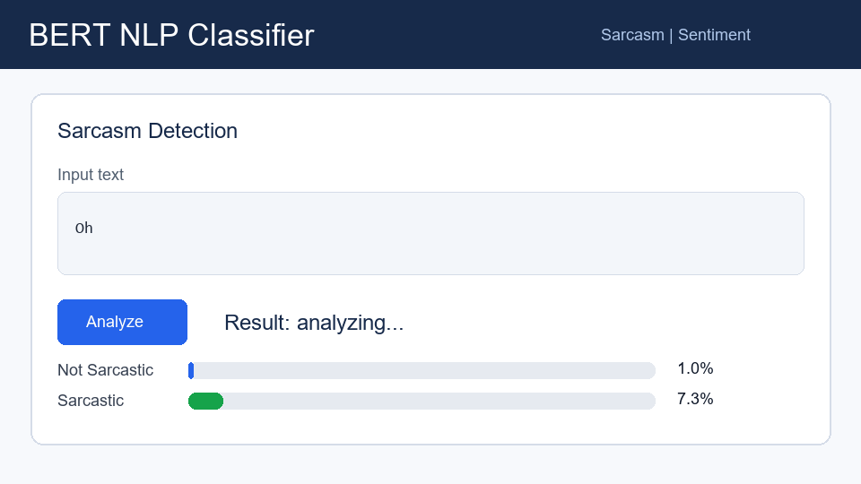

# BERT NLP Classifier



A notebook project that fine-tunes `bert-base-uncased` for two text classification tasks:

- Sarcasm detection on the balanced Reddit sarcasm dataset.
- Sentiment analysis on Reddit comments with negative, neutral, and positive labels.

The notebook trains or loads checkpoints, evaluates both classifiers, writes reusable metrics, renders a performance dashboard, and launches a Tkinter interface for live predictions.

## Highlights
- Reproducible train/validation/test splits with a configurable random seed.
- Weighted F1 and accuracy reporting for both tasks.
- Confusion-matrix dashboard exported to `performance_summary.png`.
- Desktop GUI with quick examples and confidence bars.

## Project Structure

```text
BERTtransformer.ipynb       # Training, evaluation, dashboard, and GUI
performance_summary.png     # Exported model-performance dashboard
assets/demo.gif             # README demo animation
checkpoints/                # Local model checkpoints, ignored by Git
data/                       # Optional local data folder, ignored by Git
```

## Quick Start

1. Create and activate a virtual environment.

```bash
python -m venv .venv
.venv\Scripts\activate
```

2. Install dependencies.

```bash
pip install transformers torch datasets scikit-learn pandas numpy matplotlib seaborn tqdm gradio accelerate
```

3. Place the datasets in the project root.

```text
train-balanced-sarcasm.csv
Reddit_Data.csv
```

4. Open `BERTtransformer.ipynb` and run the cells from top to bottom.

## Outputs

- `checkpoints/metrics.json` stores accuracy, weighted F1, labels, predictions, and training history.
- `performance_summary.png` visualizes model comparison, training curves, and confusion matrices.
- The final notebook cell launches the Tkinter classifier app.

## Dataset Sources

- `train-balanced-sarcasm.csv`: Kaggle [Sarcasm on Reddit](https://www.kaggle.com/datasets/danofer/sarcasm/data), based on the Self-Annotated Reddit Corpus for sarcasm research.
- `Reddit_Data.csv`: Kaggle [Twitter and Reddit Sentimental analysis Dataset](https://www.kaggle.com/datasets/cosmos98/twitter-and-reddit-sentimental-analysis-dataset).

## Git Notes

Large local artifacts are intentionally excluded by `.gitignore`: checkpoints, virtual environments, and archives should not be committed to GitHub. The large sarcasm CSV is tracked with Git LFS.
